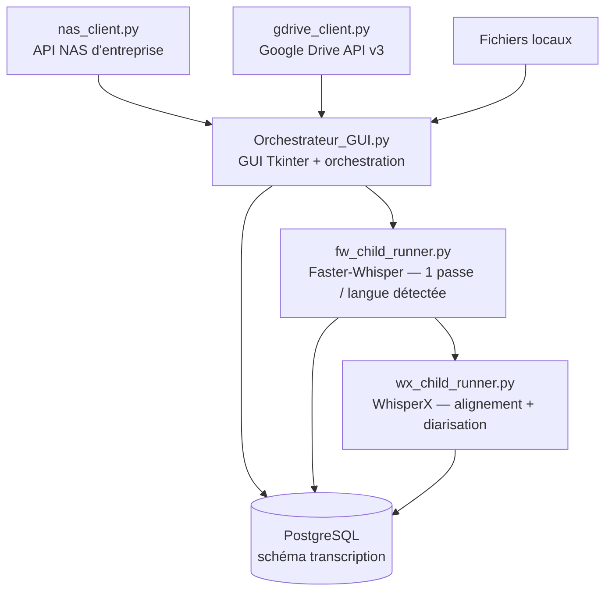

<div align="center">

# 🎙️ Transcription Pipeline

**Pipeline de transcription vidéo/audio automatisé, multi-sources et multi-langues**
*Speech-to-text batch processing • Faster-Whisper • WhisperX • GPU-accelerated • Resilience engineering*

[](https://www.python.org/)
[](https://github.com/SYSTRAN/faster-whisper)
[](https://github.com/m-bain/whisperx)
[](https://developer.nvidia.com/cuda-zone)
[](https://www.postgresql.org/)
[](LICENSE)

</div>

---

## 📌 En bref

Application desktop qui transcrit automatiquement **des milliers de vidéos**
sans supervision, depuis **trois sources différentes** (NAS d'entreprise,
Google Drive, disque local), avec **détection automatique bilingue**,
**alignement mot-à-mot**, **diarisation des locuteurs**, et une **ingénierie
de la résilience** pensée pour tourner sans surveillance sur de gros volumes
(pannes réseau, sessions qui expirent, crashs GPU natifs transitoires).

**Mots-clés** : `Python` `Speech-to-Text` `ASR` `OpenAI Whisper` `Faster-Whisper`
`WhisperX` `Speaker Diarization` `pyannote.audio` `CUDA` `GPU Computing`
`PostgreSQL` `REST API Integration` `Google Drive API` `Batch Processing`
`ETL` `Desktop Application` `Tkinter` `Resilience Engineering` `Fault Tolerance`

---

## Sommaire

- [Pourquoi ce projet](#-pourquoi-ce-projet)
- [Fonctionnalités](#-fonctionnalités)
- [Architecture](#-architecture)
- [Prérequis](#-prérequis)
- [Installation](#-installation)
- [Configuration](#-configuration)
- [Utilisation](#-utilisation)
- [Structure du dépôt](#-structure-du-dépôt)
- [Licence](#-licence)

---

## 🎯 Pourquoi ce projet

Transcrire un fonds vidéo massif — plusieurs milliers de fichiers, répartis
entre stockage réseau et cloud — de façon fiable et peu supervisée pose des
problèmes très différents de la transcription d'un seul fichier :

- des **sessions réseau qui expirent** en plein traitement d'un lot,
- des **backends tiers instables** (erreurs 5xx par vagues),
- des **plantages GPU natifs transitoires** sur du matériel grand public,
- une **cohérence des données** à maintenir quand une même vidéo change
  d'emplacement au fil du temps (Drive → NAS, par exemple).

Ce dépôt documente les solutions retenues pour chacun de ces problèmes —
voir [`docs/integrating-a-new-source.md`](docs/integrating-a-new-source.md)
pour le détail des garde-fous réseau, et [`DB_TRANSCRIPTION.md`](DB_TRANSCRIPTION.md)
pour le modèle de données.

## ✨ Fonctionnalités

| | |
|---|---|
| 🗂️ **Sources multiples, un seul pipeline** | Fichiers locaux, NAS d'entreprise (API REST), dossiers Google Drive publics (lien direct, sans OAuth) — même explorateur à cases à cocher, même traitement derrière. |
| 🌐 **Multi-langue automatique** | Détection de la langue primaire, puis **passe complète et indépendante pour chaque langue secondaire détectée** dans une même vidéo — pas une translittération, une vraie transcription par langue. |
| 🎯 **Alignement + diarisation** | WhisperX (timestamps mot-à-mot) + pyannote.audio (identification des locuteurs), avec cache local pour un fonctionnement **hors-ligne**. |
| ⚡ **GPU auto-détecté** | CUDA/CPU, type de calcul (float16/int8) choisis automatiquement, sans configuration manuelle. |
| 🛡️ **Reprise fine sur incident** | Retry à backoff progressif (réseau/5xx), keepalive de session, reprise automatique après crash GPU natif, suivi du statut **par (média, langue)** — une langue en échec est retentée seule, jamais de retraitement inutile. |
| 🔗 **Réconciliation d'identité** | Une vidéo retrouvée à un nouvel emplacement (nom + taille identiques) est reconnue comme la même, jamais retranscrite en double — historique conservé. |
| ⏸️ **Pause/Stop réels** | Suspendent/tuent effectivement le sous-processus en cours (`psutil`), pas un signal ignoré. |
| 🗄️ **Base de données dédiée** | Schéma PostgreSQL `transcription` (runs → transcripts → fichiers), vue de suivi en temps réel. |
| 🖥️ **Pilotable à distance** | Conçu pour tourner sur une machine GPU dédiée, pilotée depuis ailleurs (VS Code Remote Tunnels, Chrome Remote Desktop). |

## 🏗️ Architecture



Chaque source implémente la même interface minimale (`browse()` /
`download_file()`) — voir [`docs/integrating-a-new-source.md`](docs/integrating-a-new-source.md)
pour en brancher une nouvelle.

Les moteurs de transcription tournent dans des **sous-processus avec leurs
propres environnements virtuels**, isolés du process GUI : un crash GPU
natif dans l'un d'eux n'affecte jamais l'interface, et chacun peut avoir
des versions de dépendances incompatibles entre elles sans conflit.

## ✅ Prérequis

1. **Python 3.10+**
2. **FFmpeg** dans le PATH (`ffprobe` inclus)
3. **GPU NVIDIA + CUDA** (optionnel mais fortement recommandé)
4. Un serveur PostgreSQL accessible (ex: un projet [Supabase](https://supabase.com) gratuit)
5. Un fichier `config.json` à la racine (voir [Configuration](#-configuration))

## 📦 Installation

```bash
git clone https://github.com/MahounanDANSOU/Transcription-Pipeline.git
cd Transcription-Pipeline

# 1. Environnement principal (GUI + DB + clients API)
python -m pip install -r requirements.txt

# 2. Environnement Faster-Whisper (venv dédié)
python -m venv Faster-Whisper/fw_env
Faster-Whisper/fw_env/Scripts/pip install -r fw_requirements.txt

# 3. Environnement WhisperX (venv dédié)
python -m venv WhisperX/wx_env
WhisperX/wx_env/Scripts/pip install -r wx_requirements.txt
```

## ⚙️ Configuration

Copie `config.example.json` en `config.json` (déjà dans `.gitignore` —
jamais commité) et remplis tes propres valeurs :

```bash
cp config.example.json config.json
```

| Clé | Description |
|---|---|
| `db_host`, `db_port`, `db_name`, `db_user`, `db_password`, `db_sslmode` | Connexion PostgreSQL |
| `hf_token` | Token Hugging Face (modèles d'alignement/diarisation) |
| `fw_python`, `wx_python` | Chemins vers les interpréteurs des venvs dédiés |
| `local_model_dir` | Dossier de modèles pré-téléchargés (chargement hors-ligne) |
| `nas_api_url`, `nas_username`, `nas_password` | Accès à ton API NAS (voir `nas_client.py`) |
| `google_drive_api_key` | Clé API Google Cloud (API Drive v3 activée) — pour les dossiers Drive **publics** uniquement |

## ▶️ Utilisation

```bash
python Orchestrateur_GUI.py
```

1. Détection matérielle + connexion DB automatiques au démarrage.
2. Choisis une source : fichiers/dossiers **locaux**, ou coche **NAS**/**Drive**
   puis parcours l'arborescence et coche ce qui doit être traité.
3. Choisis le modèle (`large-v3` recommandé), active l'alignement/la
   diarisation si besoin.
4. **▶ Lancer le batch** — Pause/Stop disponibles à tout moment.

## 📁 Structure du dépôt

```
Orchestrateur_GUI.py           GUI + orchestration complète du pipeline
fw_child_runner.py             Transcription Faster-Whisper
wx_child_runner.py             Alignement/diarisation WhisperX
language_utils.py              Détection de langue par segment
nas_client.py                 Client API NAS
gdrive_client.py               Client Google Drive
predownload_align_models.py    Pré-téléchargement des modèles (usage hors-ligne)
DB_TRANSCRIPTION.md            Modèle de données et vues de suivi
docs/integrating-a-new-source.md   Comment brancher une nouvelle source
```

## 📄 Licence

MIT — voir [`LICENSE`](LICENSE).

<div align="center">

*Conçu et développé en autonomie, de l'architecture au déploiement en production.*

</div>
